# Azalea e-Helpdesk: the help guide

For hotel owners, managers, supervisors and staff of Azalea Baguio and Azalea Boracay.

## 0. How to use this guide

Read section 1 to see what the desk does. Then read the sections for your own kind of person (section 2 shows which one you are). Each screen has a picture with numbers. The list under the picture says what each number is.

- [1. What this is and why it helps](#1-what-this-is-and-why-it-helps)
- [2. Who can do what](#2-who-can-do-what)
- [3. Signing in](#3-signing-in)
- [4. The desk, screen by screen](#4-the-desk-screen-by-screen)
  - [4.1 Requests](#41-requests)
  - [4.2 New request](#42-new-request)
  - [4.3 A request](#43-a-request)
  - [4.4 Safety alert](#44-safety-alert)
  - [4.5 Work orders](#45-work-orders)
  - [4.6 Housekeeping](#46-housekeeping)
  - [4.7 Handover](#47-handover)
  - [4.8 Insights](#48-insights)
  - [4.9 Settings](#49-settings)
  - [4.10 Staff](#410-staff)
  - [4.11 Logins](#411-logins)
  - [4.12 Lists](#412-lists)
- [5. A day as each kind of person](#5-a-day-as-each-kind-of-person)
- [6. On your phone and when the internet drops](#6-on-your-phone-and-when-the-internet-drops)
- [7. Your hotel's own look](#7-your-hotels-own-look)
- [8. Common questions and fixes](#8-common-questions-and-fixes)
- [9. Words used in this guide](#9-words-used-in-this-guide)
- [10. For the web team only](#10-for-the-web-team-only)

## 1. What this is and why it helps

A guest calls the front desk. Their air conditioner is warm.

The receptionist taps the room number. She taps "AC not cold". She taps "Log request". That is all.

The request goes to Engineering. The engineer's phone shows it. A timer starts. If nobody picks it up in time, the request turns red and the manager sees it. When the engineer is done, he taps "Done". The next shift can read the whole story. Nothing lives in someone's head.

The desk also helps with bigger things:

- **Repairs.** A small problem can grow into a repair job with a cost. The desk follows it to the end.
- **Cleaning.** Housekeeping sees which rooms are ready to clean.
- **Danger.** If someone types "smoke", the desk shows a red warning. It tells everyone to call for help first.
- **Shift change.** One screen shows the next shift what is open, late or promised to a guest.

**It works on a phone.** Use it on the front desk computer or on any phone.

**It keeps working when the Wi-Fi drops.** Your work is saved on your phone and sent when the connection comes back (see [section 6](#6-on-your-phone-and-when-the-internet-drops)).

**Each hotel keeps its own data.** Azalea Baguio and Azalea Boracay use the same desk. They never see each other's requests, people or lists.

You find the desk at the **/helpdesk/** address of your hotel's website. For example: your hotel's web address followed by `/helpdesk/`.

> The desk is a logbook and a messenger. It is **not** a fire alarm or a life-safety system. For danger, call 911 or use the radio first. Radios and written safety plans always come first.

## 2. Who can do what

There are four kinds of people. Each one has a login (an email and a password). Your hotel owner chooses which kind you are.

| | Hotel owner | Manager | Supervisor | Shared phone |
|---|:---:|:---:|:---:|:---:|
| **Requests** tab | ✔ | ✔ | ✔ | ✔ |
| **Work orders** tab | ✔ | ✔ | ✔ | ✔ |
| **Housekeeping** tab | ✔ | ✔ | ✔ | ✔ |
| **Handover** tab | ✔ | ✔ | ✔ | ✔ |
| **Insights** tab | ✔ | ✔ | ✔ | – |
| **Settings** tab | ✔ | ✔ | ✔ | – |
| Settings: text size and display | ✔ | ✔ | ✔ | – |
| Settings: **Staff** (people with a PIN) | ✔ | ✔ | – | – |
| Settings: **Lists** (departments and more) | ✔ | ✔ | – | – |
| Settings: **Logins** (add or switch off) | ✔ | – | – | – |
| Log requests and finish jobs | ✔ | ✔ | ✔ | with a PIN |
| Raise a safety alert, record the 911 call | ✔ | ✔ | ✔ | with a PIN |
| Sign off to close a safety alert | ✔ | ✔ | – | – |
| Sign the handover | ✔ | ✔ | ✔ | with a PIN |
| Acts under their own name, no PIN needed | ✔ | ✔ | ✔ | – |

A ✔ means yes. A dash means no.

**What "with a PIN" means.** A shared phone sits at a station. Many people use it, for example the room attendants. The phone has its own login. But the phone alone cannot do anything. Each person picks their name and types a four-digit **PIN**. Then the desk knows who is working. Every change is saved under that person's name.

**Staff with a PIN** do not need an email or password. A manager or the owner adds them in **Settings, Staff** ([section 4.10](#410-staff)). A staff person can be a **Desk officer**, **Staff** or **Supervisor**. These are the words you see on the name cards.

A hotel owner or manager can also act as one of these staff people. Use **Switch person** and type that person's PIN. Settings then shows **Back to my own account**.

1. All the tabs: the hotel owner sees Requests, Work orders, Housekeeping, Handover, Insights and Settings.
2. Who is signed in: your name and your kind of person, at the bottom of the menu.

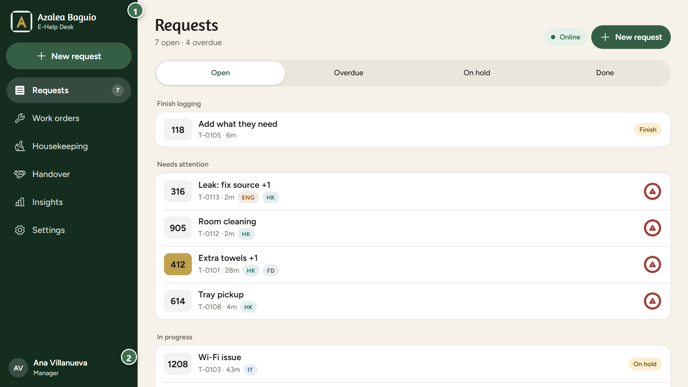

1. All the tabs: a manager sees the same six tabs.
2. Who is signed in: here "Manager".

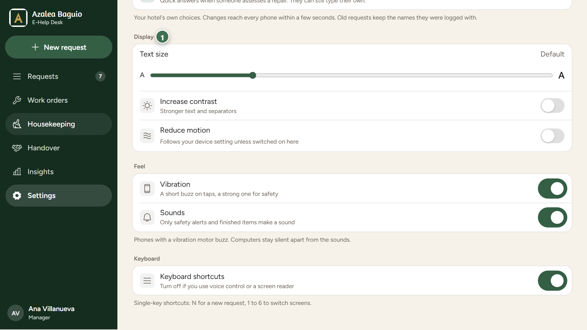

1. Display options: a manager sees Staff and Lists in Settings. There is no **Logins** section.

1. All the tabs: a supervisor sees six tabs.
2. Who is signed in: here "Supervisor".

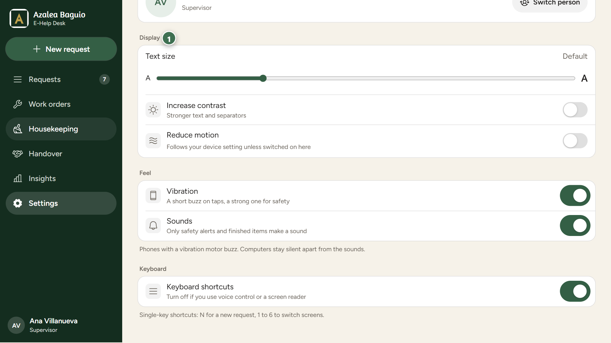

1. Display options: a supervisor sees only the display options. There is no Staff, Lists or Logins.

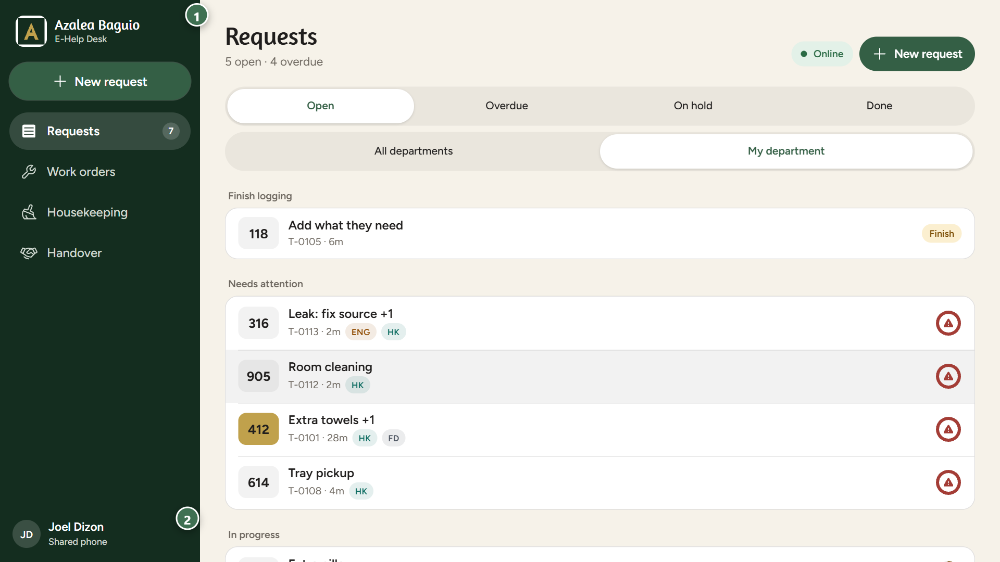

1. Only four tabs: a shared phone has no Insights and no Settings.
2. Who is signed in: the person who typed their PIN. It says "No one signed in" until someone does.

## 3. Signing in

### 3.1 The sign-in page

Open your hotel's **/helpdesk/** address. If you are not signed in, the sign-in page opens by itself. It shows your hotel's name and colours.

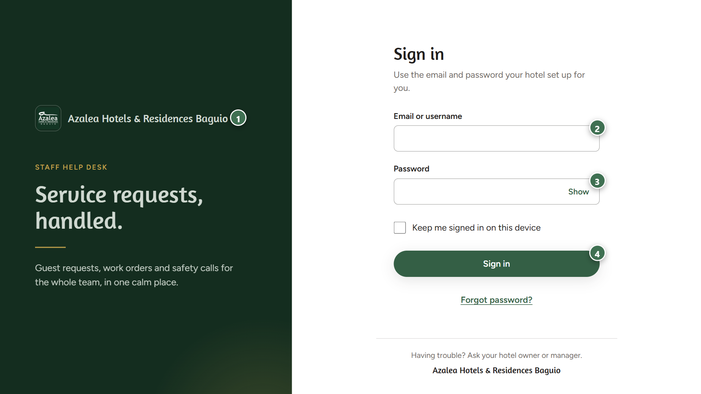

1. Hotel name and logo: this tells you that you are on the right hotel's page.
2. Email or username: type the email your hotel set up for you.
3. Password: type your password. Tap **Show** to see what you typed.
4. Sign in: tap it to go to the desk.

Three more parts have no number:

- **Keep me signed in on this device.** Tick this on your own phone or computer. Do not tick it on a computer other people use.
- **Forgot password?** Tap it if you cannot remember your password.
- At the bottom: "Having trouble? Ask your hotel owner or manager."

The Boracay page is the same, in teal.

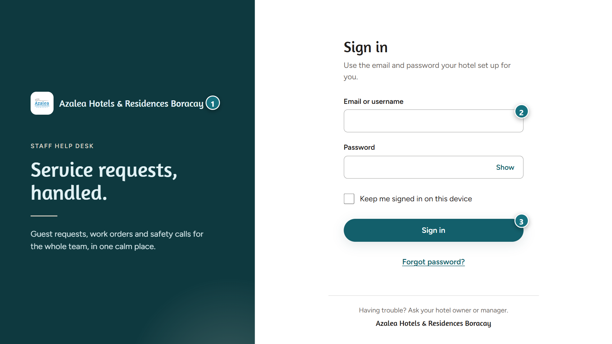

1. Hotel name and logo: Azalea Hotels & Residences Boracay.
2. Email or username: the same box as at Baguio.
3. Sign in: the same button, in teal.

**How long you stay signed in:**

- Owner, manager or supervisor, with "Keep me signed in" ticked: **7 days**.
- Owner, manager or supervisor, without it: **12 hours**.
- Shared phone: **30 days**.

**If you see a message:**

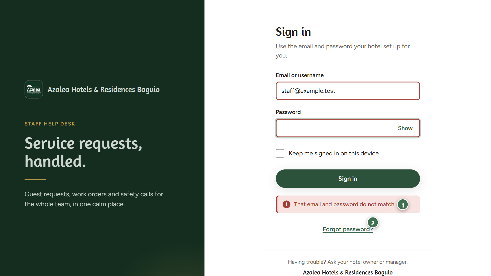

1. Message about the wrong password: "That email and password do not match." Check both and try again.
2. Forgot password?: use this link if you cannot remember your password.

| Message | What it means | What to do |
|---|---|---|
| That email and password do not match. | The email or the password is wrong. This message is the same when the login is switched off or has no desk access. | Check both. Use **Forgot password?** if needed. Ask your owner if it still fails. |
| This page has expired. Reload it and try again. | The page was open for too long (over 2 hours). | Reload the page and sign in again. |
| Too many attempts. Try again in 15 minutes. | You or someone on your network failed too many times. | Wait. See the next paragraph. |

**The short pause.** After **5 wrong tries** with the same email on the same device, you are paused for **15 minutes**. If one place makes **20 wrong tries in an hour**, that place is paused for **1 hour**. The message says how many minutes to wait. A right password does not work during the pause. Just wait.

### 3.2 Forgot your password

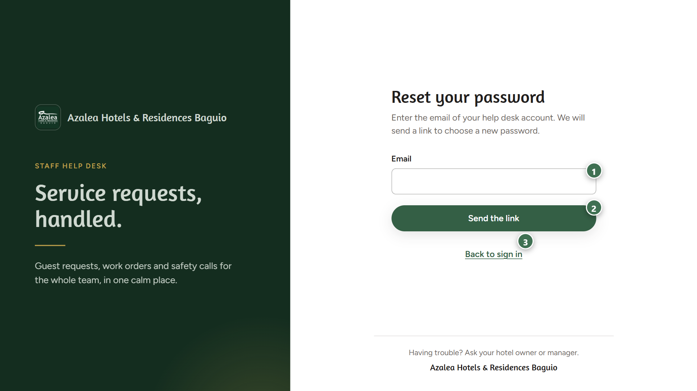

1. Email: type the email of your help desk login.
2. Send the link: tap it.
3. Back to sign in: go back if you remember your password.

The steps:

1. On the sign-in page tap **Forgot password?**
2. Type the email of your help desk login. Tap **Send the link**.
3. The page always says: "If that email has an account, a link is on its way." It says this even if the email is not known. That keeps accounts private.
4. Open the email. Tap the link. It works **once** and ends after **one day**.
5. Type a new password twice (**New password**, **Type it again**). Use at least **10 characters**. Do not use your email as your password. Tap **Save password**.
6. Tap **Sign in** and use the new password.

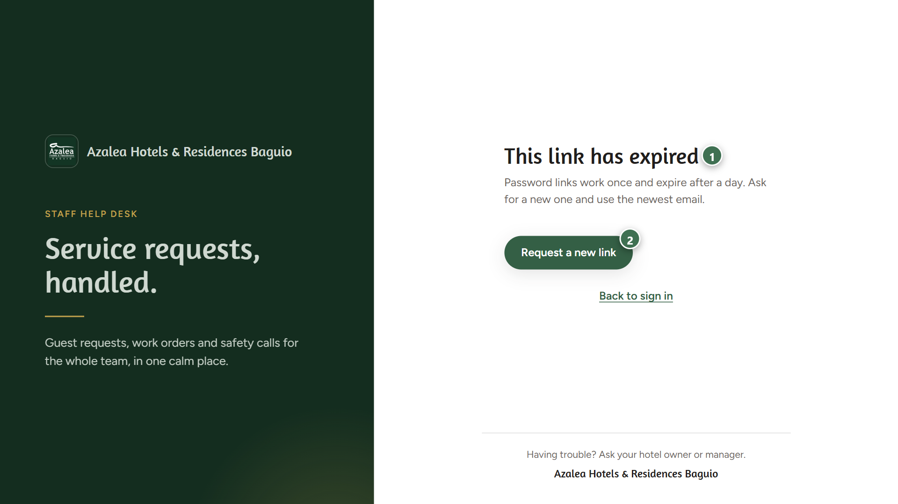

1. This link has expired: the link was used already, or it is more than a day old.
2. Request a new link: tap it, then use the newest email.

You can ask for a link only **3 times an hour**.

If no email arrives, check your spam folder. Then ask your owner or the web team. See [section 8](#8-common-questions-and-fixes).

### 3.3 Signing out

On a computer, tap your name at the bottom of the side menu. Tap **Sign out**. On a phone, tap your picture (round) at the top, or tap **More** and then **Sign out**. Signing out also ends any PIN sign-in on that login.

### 3.4 The shared phone: pick your name, type your PIN

A shared phone opens on the screen **Who's on shift?** Nothing else works until a person signs in.

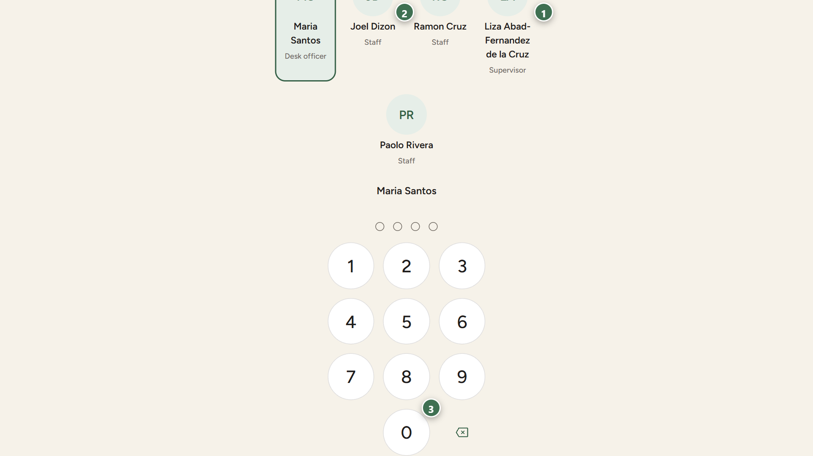

1. Names of the people on shift: every staff person added by a manager is here, with a round badge and their role.
2. Pick a name: tap your own card. It turns green.
3. Your PIN (the keypad and the four dots): tap your four digits, one for each dot. The desk opens by itself after the fourth digit. There is no "enter" button.

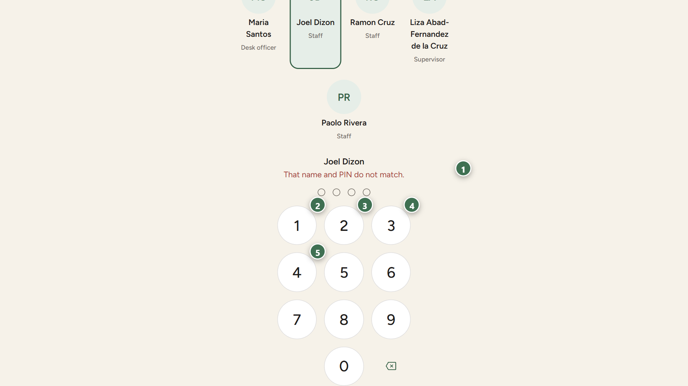

1. Message about the wrong PIN: it says "That name and PIN do not match." The dots clear and nothing opens.
2. to 5. Try again: tap your four digits again.

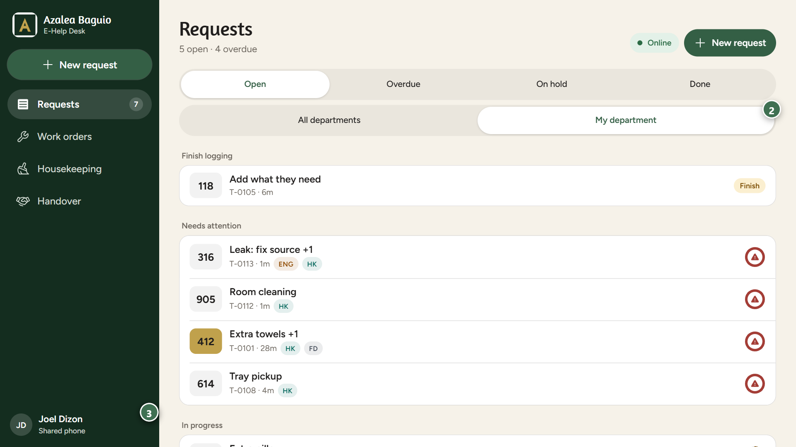

1. Who is signed in: the person's name shows at the bottom.
2. Only my department: the list opens with only the work of your own department (see [4.1](#41-requests)).
3. Open the person menu: tap the name to find **Switch person** and **Sign out**.

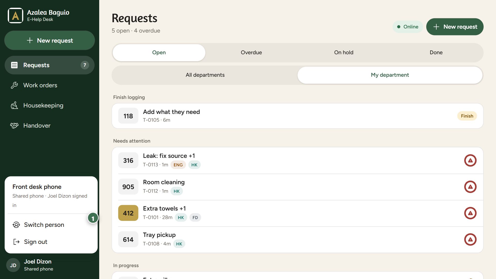

1. Switch person: tap it when the shift changes hands. The next person signs in with their own PIN.

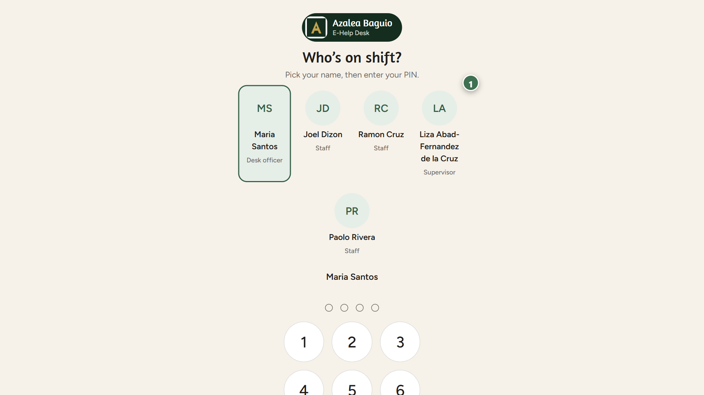

1. Names of the people on shift: nobody inherits the last person's sign-in.

**PIN rules in plain words:**

- A PIN has **four digits**. Numbers only.
- A manager or owner picks your first PIN. Keep it private.
- The desk refuses weak PINs. No repeats like 1111. No straight runs like 1234 or 4321.
- After **5 wrong PINs** that person is locked for **15 minutes**. The lock follows the person, not the phone. While locked, even the right PIN fails and the same message shows.
- A PIN is never shown again after it is saved. If you forget it, a manager sets a new one ([4.10](#410-staff)). A new PIN also removes a lock.
- Your PIN sign-in lasts **12 hours**. After that the desk says "Your PIN sign-in has ended. Sign in with your PIN." Just sign in again.
- If a shared phone tries to act with nobody signed in, it says "Sign in with your PIN first."

## 4. The desk, screen by screen

On a computer you see a menu on the left. On a phone you see tabs at the bottom (see [section 6](#6-on-your-phone-and-when-the-internet-drops)). The tabs are: **Requests**, **Work orders**, **Housekeeping**, **Handover**, **Insights** and **Settings**.

Keyboard shortcuts on a computer: press **N** for a new request. Press **1** to **6** to open a tab. You can turn the shortcuts off in Settings.

### 4.1 Requests

This is the home screen. It lists every guest request that is still open. A **request** is one guest need, like "extra towels". The screen also calls it a **ticket**.

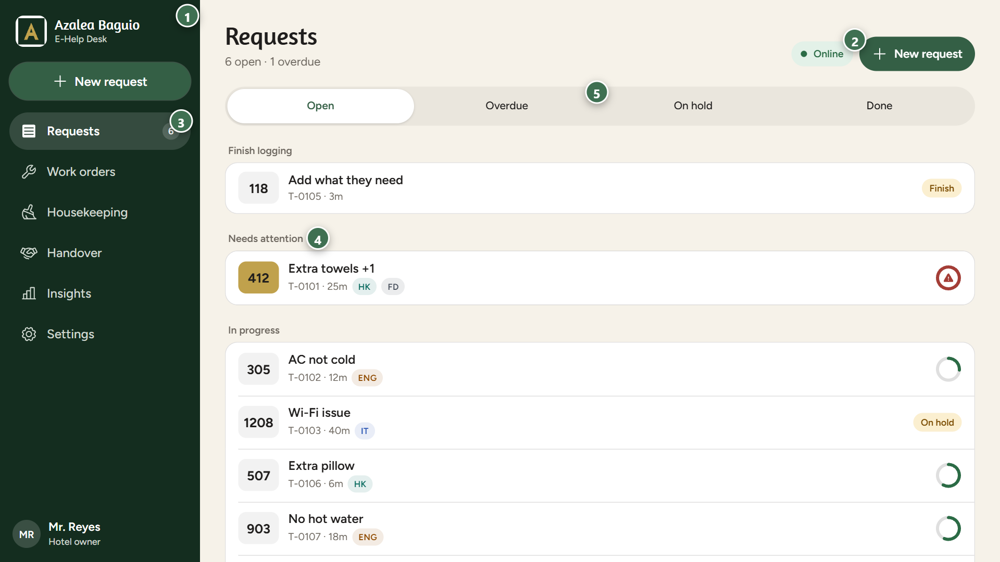

1. Hotel name and logo: this tells you which hotel's desk you are on.
2. Connection chip: it says **Online** when all is well. It says **Syncing** and a number when your phone is still sending changes. It says **Offline** when the connection is gone (see [section 6](#6-on-your-phone-and-when-the-internet-drops)).
3. Number of open requests: the badge beside **Requests** counts requests that still have open work.
4. Needs attention group: late requests and VIP guests go to the top.
5. Overdue tab: shows only the late requests.

Read one row from left to right:

- The **room** number. A gold room badge means a VIP guest.
- The **name** of the need, for example "AC not cold". "+1" means one more open need in the same request.
- The **ticket** number, such as T-0101, and how long ago it was logged.
- Small **department tags**, for example HK (Housekeeping) or ENG (Engineering).
- On the right, a **ring** or a **badge**.

**The ring** is the timer. It fills as time passes. It changes colour at three quarters of the target time. It turns red with a warning mark when the time is up.

**The badges:**

- **Finish** (amber): a room was saved with no need yet ([4.2](#42-new-request)).
- **On hold**: the request is waiting and its timer is stopped.
- **Waiting**: the request waits for an earlier step.
- **Done**: all work is finished.

A small cloud mark beside the ticket number means the request is saved on your phone but not sent yet.

**The four tabs:**

- **Open**: groups called **Finish logging**, **Needs attention** and **In progress**.
- **Overdue**: requests that took longer than their target time.
- **On hold**: requests that are waiting.
- **Done**: finished requests ("Done this shift", the last 12).

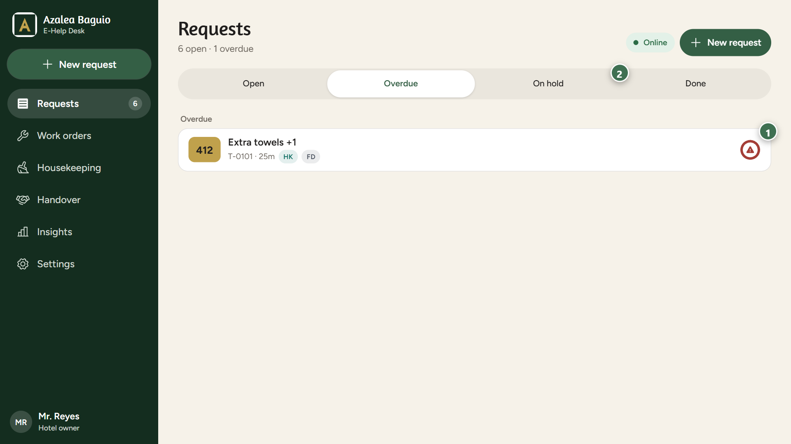

1. A late request: tap it to open it.
2. On hold tab: the next tab.

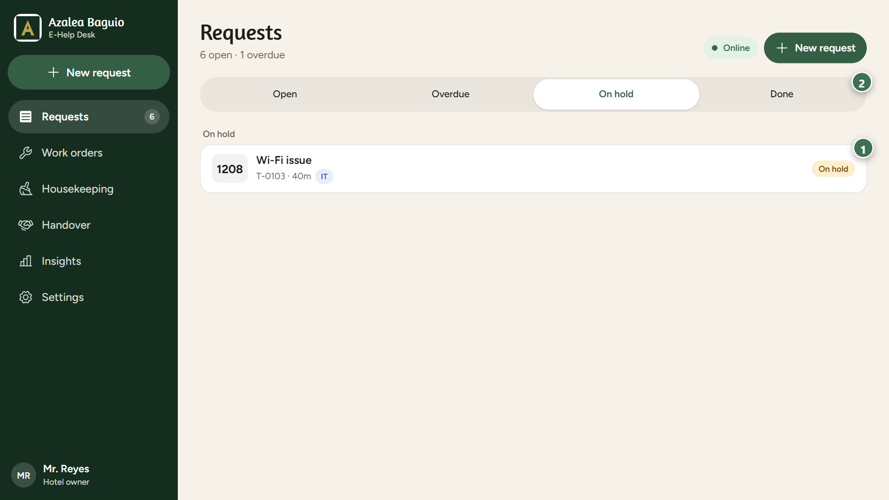

1. A request on hold: for example a guest who does not want to be disturbed. Its timer is stopped.
2. Done tab: the next tab.

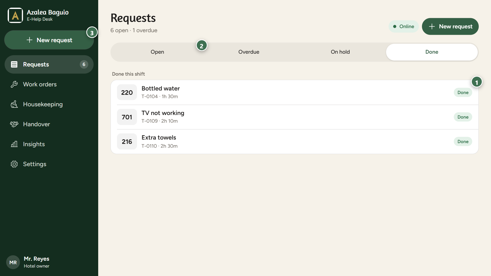

1. A finished request: finished requests stay here so the Open list stays short.
2. Open tab: go back to the live list.
3. New request: starts a new request.

**Who sees what in the list.** If you have a department, a second switch appears: **All departments** and **My department**. Staff start on **My department**. Tap **All departments** to see everything.

**On a phone, swipe a row:**

- Swipe **right** to do the next step (the step is named on the row).
- Swipe **left** to put it on **Hold**. The desk uses "Guest on Do Not Disturb" if your hotel has that reason. Otherwise it uses the first reason in your list.

**Safety banner.** While a safety alert is open, a red banner stays at the top of the list for everyone: "INC-001 is active. Staff notified (not BFP/911). Tap to open." See [4.4](#44-safety-alert).

**Good to know**

- The timer rules are simple. A **new** request must be sent to its team within **2 minutes**. After that, the target time for the job starts. A request type's target time is in minutes (see [4.12](#412-lists)). A hold stops the timer.
- A request that has two jobs, like a leak, shows the first open job and "+1".
- A quiet day shows: "No open requests. When a guest calls, log the room and what they need."

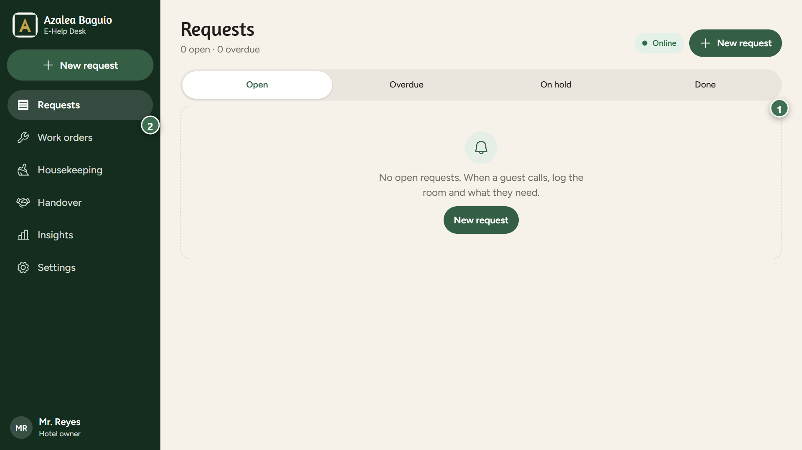

1. Nothing open: the screen says so and offers **New request**.
2. Open Work orders: the next tab.

**If something looks wrong**

- *A request is missing.* Check the **Done** tab. Finished work moves there. Also check **My department** versus **All departments**.
- *The number does not match the list.* The badge counts requests. A request with two jobs counts once.
- *The chip says Offline.* See [section 6](#6-on-your-phone-and-when-the-internet-drops).

### 4.2 New request

Tap **New request**. A sheet opens: **Room, then what they need. No typing required.**

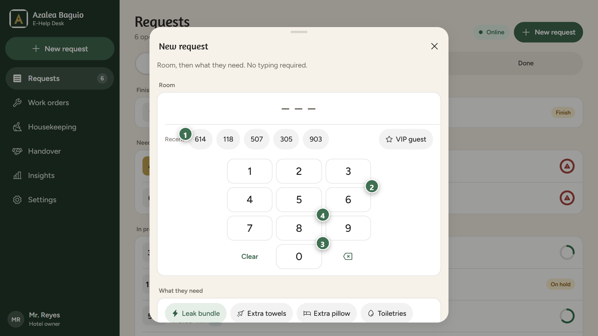

1. Rooms used recently: your last five rooms show as buttons. Tap one to use it again.
2. First digit: tap **6**. A room has 3 or 4 digits.
3. Second digit: tap **0**.
4. Third digit: tap **8**. The room now reads 608. Use **Clear** to start again. Use the small arrow key to delete the last digit.

Beside the recent rooms there is a **VIP guest** button. Tap it if the guest is a VIP. The request then goes to the top of the list under **Needs attention**.

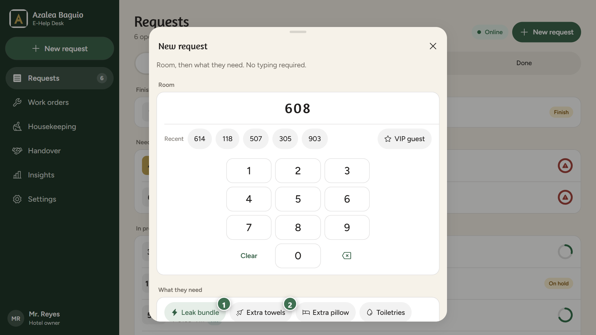

1. A bundle for bigger problems: a **bundle** sends work to two teams at once (see below).
2. Extra towels: tap what the guest asked for. You can tap more than one.

Each button is a **request type**. Your hotel decides which buttons you see ([4.12](#412-lists)). The starting buttons and their target times are:

| Button | Team | Target time |
|---|---|---|
| Extra towels | Housekeeping | 10 min |
| Extra pillow | Housekeeping | 10 min |
| Toiletries | Housekeeping | 10 min |
| Room cleaning | Housekeeping | 30 min |
| Checkout inspection | Housekeeping | 25 min |
| AC not cold | Engineering | 45 min |
| Light bulb | Engineering | 30 min |
| No hot water | Engineering | 30 min |
| Wi-Fi issue | IT | 20 min |
| TV not working | IT | 20 min |
| Bottled water | Food & Beverage | 10 min |
| Tray pickup | Food & Beverage | 15 min |
| Late checkout | Front Desk | 15 min |
| Noise complaint | Security | 10 min |

The **Leak bundle** starts two jobs. Engineering fixes the source first (20 minutes). Housekeeping cleans up after (25 minutes). The clean-up waits until the repair is done.

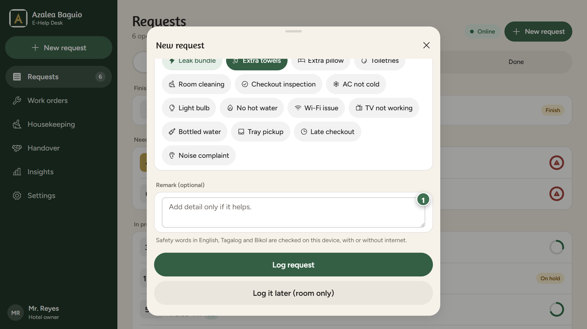

1. Remark box: add a short note only if it helps. It is optional. The desk checks your words for danger. It reads English, Tagalog and Bikol, even with no internet.

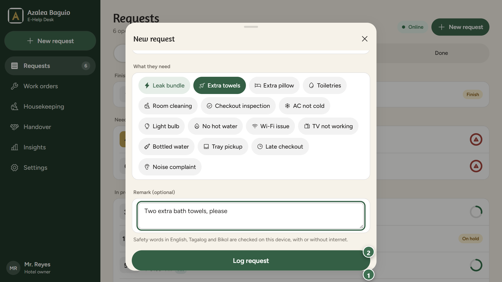

1. Log it later (room only): saves only the room (see below).
2. Log request: sends the request to the right team. It turns on when you have a room (3 digits or more) and at least one need.

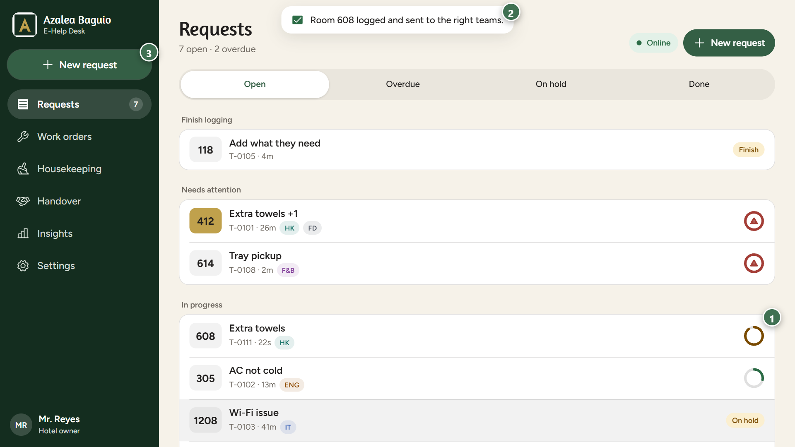

1. The new request: it shows in the list at once.
2. Confirmation message: "Room 608 logged and sent to the right teams."
3. New request: log the next one.

**Log it later.** A guest is still talking? Tap **Log it later (room only)**. Only the room is saved. The message says "Add what they need from Finish logging."

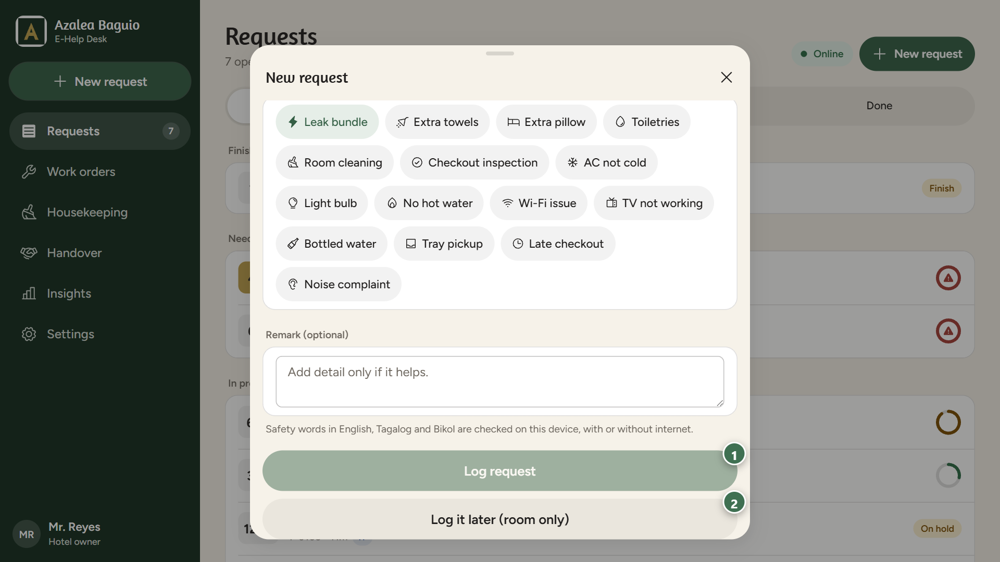

1. Log request waits for a choice: it stays grey until you pick a need.
2. Log it later (room only): ready as soon as the room has 3 digits.

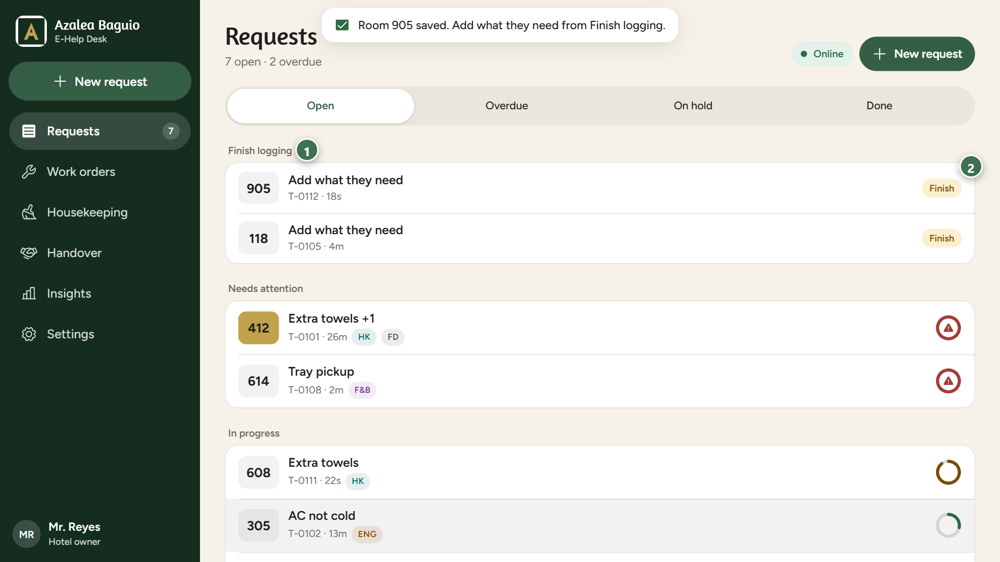

1. Finish logging group: rooms saved without a need wait here. The row says "Add what they need" and **Finish**.
2. The saved room: tap it.

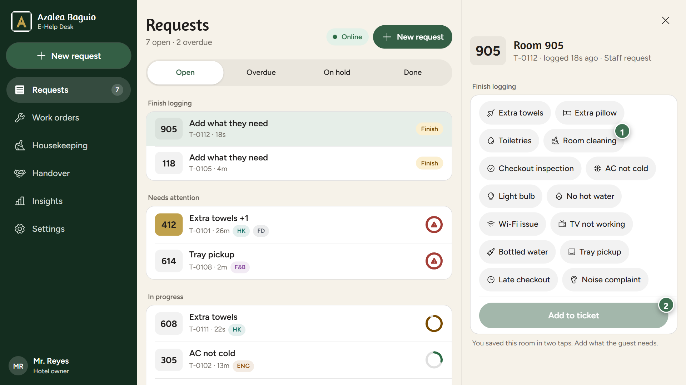

1. Room cleaning: tap what the guest needs.
2. Add to ticket: the request goes to the team like any other.

**Bundles.** Tap a bundle button (it has a small bolt) to start several jobs at once. A line under the buttons says which teams will work and in what order. Later steps wait.

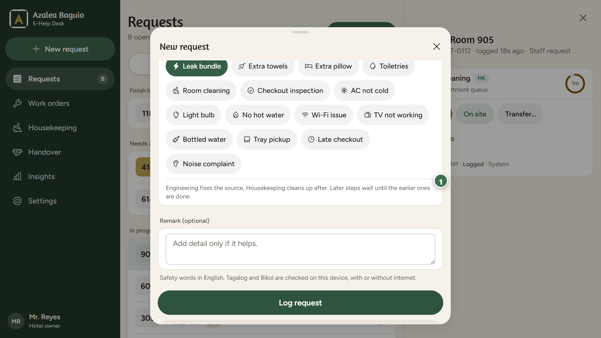

1. What the bundle does: "Engineering fixes the source, Housekeeping cleans up after. Later steps wait until the earlier ones are done." Then tap **Log request** to start both jobs.

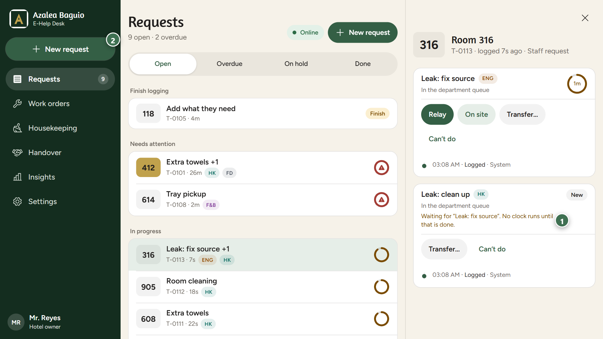

1. Clean-up waits for the repair: the second job says "Waiting for ..." and its timer does not run.
2. New request: log the next one.

**The safety warning.** If your remark has a danger word, a red box appears and **Log request** turns off. See [4.4](#44-safety-alert).

**Good to know**

- Any room number of 3 or 4 digits works. The desk does not check it against a room list. Check the number before you log.
- A phone can log a request with no internet ([section 6](#6-on-your-phone-and-when-the-internet-drops)).
- If your hotel has no request types, the sheet says "No request types yet. A manager adds them in Settings, Lists. You can still log the room now."

**If something looks wrong**

- *Log request is grey.* You need a room of 3 digits and at least one need. Or the safety warning is showing. Clear it or raise the alert.
- *A button is missing.* A manager may have archived it ([4.12](#412-lists)).

### 4.3 A request

Tap a request in the list. On a computer it opens on the right. On a phone it opens as a sheet titled **Ticket**.

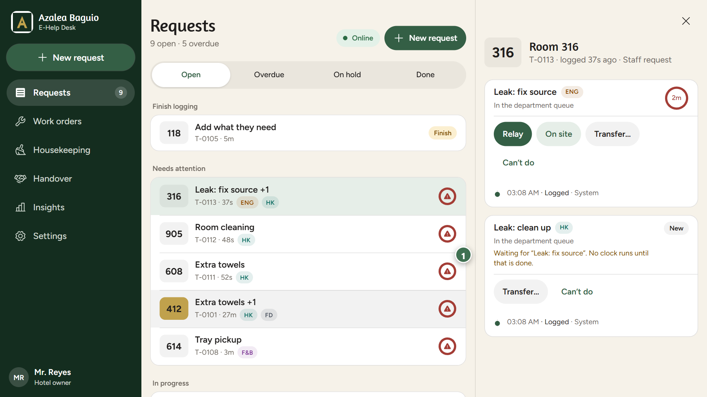

1. Room 608 towels: tap any row to open its details.

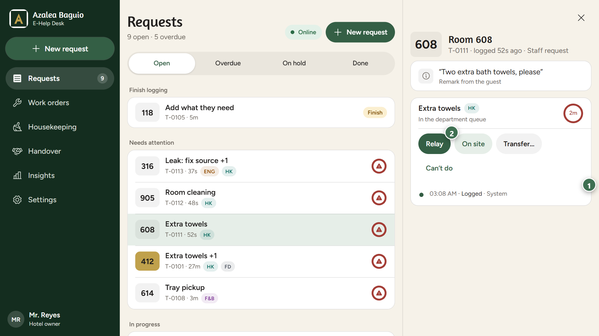

1. History of the request: the last steps, with the time and who did them.
2. Relay (pass it to the right team): sends the request to its team. A new request starts here.

At the top you see the room, the ticket number, how long ago it was logged and a **VIP** tag if it applies. Under it, the guest's remark shows. Each need has its own card. The card shows the team, who it is assigned to ("In the department queue" if nobody yet) and the timer.

**The steps of a need:**

1. **Relay (pass it to the right team).** The team gets it. The desk gives it to the first staff person on shift in that team.
2. **On site (someone is at the room).** A new request also shows **On site** to skip the first step.
3. **Done (the work is finished).**

**Other buttons on a card:**

- **Hold… (pause it and say why).** See below.
- **Resume (start the timer again).** Back to work after a hold.
- **Transfer… (move it to another team).**
- **Escalate to work order (turn it into a repair job).**
- **Can't do (close it because it cannot be done).**

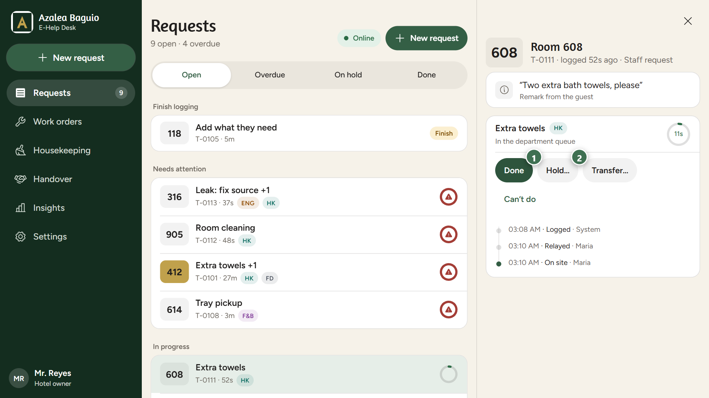

1. Done button: closes the need. The timer stops.
2. Hold… (pause it and say why): tap it when the guest cannot be served yet.

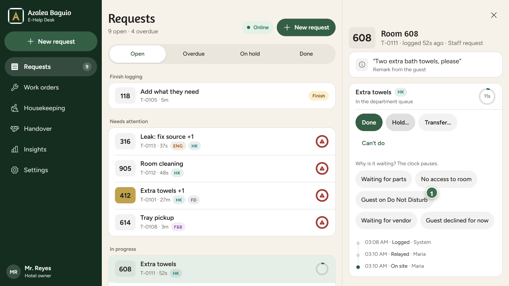

1. Guest on Do Not Disturb: tap the reason. The timer stops so the team is not marked late.

The starting hold reasons are: **Waiting for parts**, **No access to room**, **Guest on Do Not Disturb**, **Waiting for vendor** and **Guest declined for now**. Your hotel can change them ([4.12](#412-lists)). You can hold a need only after it is sent to the team.

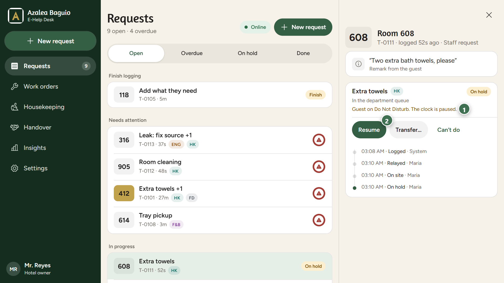

1. Reason and paused clock: the card says why it waits and "The clock is paused."
2. Resume: tap it when the guest is ready. The timer goes on from where it stopped.

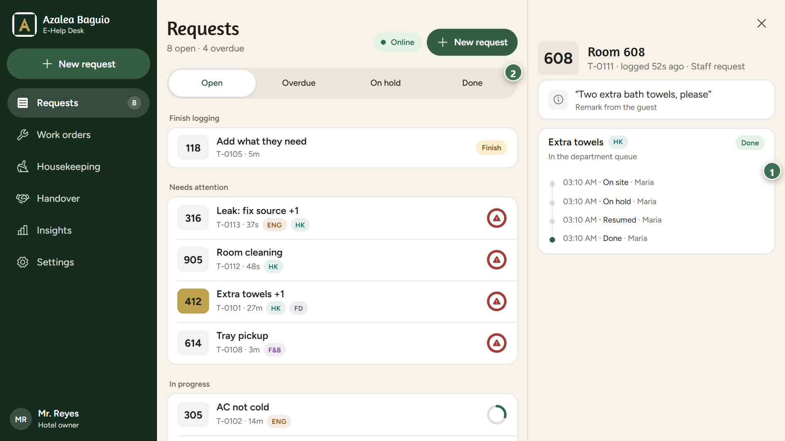

1. History of every step: each line shows the time, the step and the person.
2. Done tab: finished requests move here.

**Wrong team? Transfer.** The old card closes as "Transferred". A new card starts for the new team. The new card says "transferred in" and is a fresh request for that team.

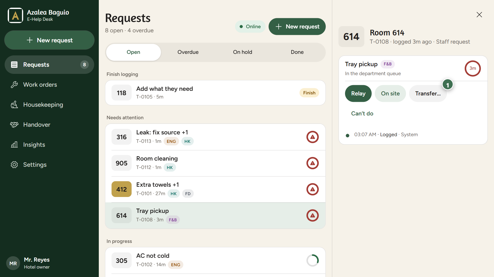

1. Transfer… (move it to another team): tap it, then tap the team that should take over.

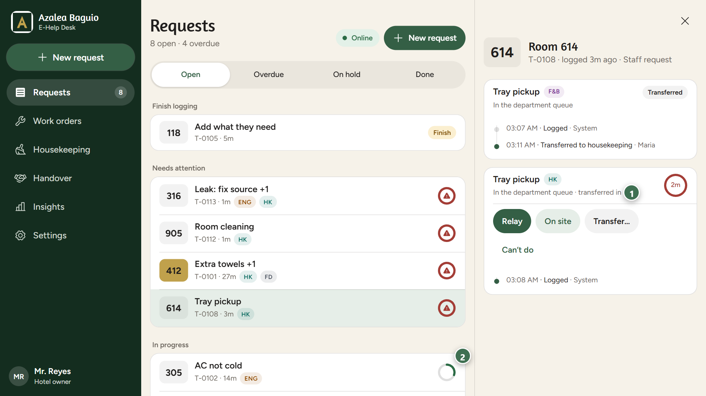

1. Moved to another team: the old line says Transferred.
2. AC not cold request: the new line for the new team.

**A bigger repair? Turn it into a work order.** The button **Escalate to work order** shows when the need is **On site** (or **On hold**) and its team **handles repairs**. At first that is Engineering and IT. See [4.12](#412-lists).

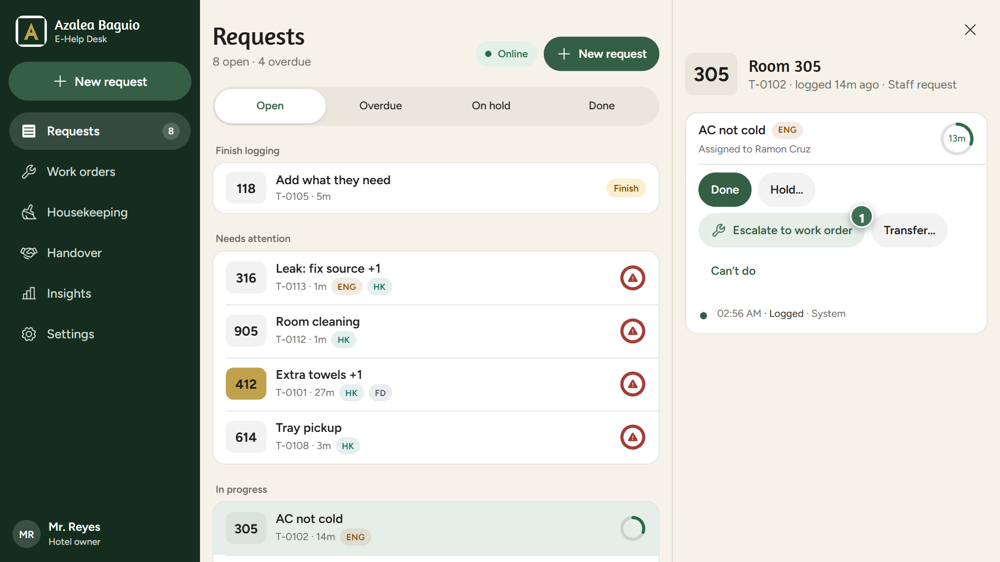

1. Escalate to work order (turn it into a repair job): the job is followed until it is finished.

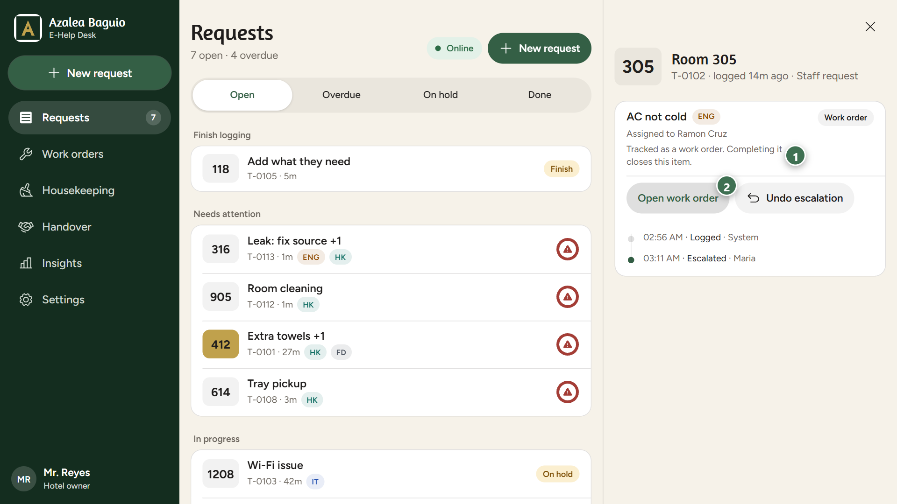

1. Tracked as a work order: "Tracked as a work order. Completing it closes this item."
2. Open work order: goes to the repair job ([4.5](#45-work-orders)). **Undo escalation** brings the request back, as long as the repair job is not done.

**Duplicate and Cancel have no button.** The desk knows these two words, but the screen has only **Can't do**. Use **Can't do** to close a need that should not go on, and tell your manager why.

**Good to know**

- A need that waits for an earlier step shows "Waiting for ..." and no clock runs. You cannot finish it yet.
- Finishing a need with "checkout" or "inspection" in its name turns the room's waiting cleaning task **Ready** in Housekeeping ([4.6](#46-housekeeping)).
- Every step is saved with the time and the person. You cannot delete history.

**If something looks wrong**

- *No Hold button.* Hold shows only after **Relay**. It also needs at least one hold reason in the list.
- *No Escalate button.* The need must be **On site** or **On hold**. Its team must handle repairs. Ask a manager.
- *"This ticket is no longer available."* The request is old. Finished requests leave the desk after 2 days. See [section 8](#8-common-questions-and-fixes).

### 4.4 Safety alert

A **safety alert** warns everybody about danger. It does not call anyone.

**What starts it.** You type a danger word in the **Remark** of a new request. The desk reads English, Tagalog and Bikol. It does this on your device, even with no internet. It listens for these dangers:

| Danger | Example words | What the screen says to do |
|---|---|---|
| Smoke or fire | smoke, fire, burning, usok, sunog | Leave the area. Call the fire line and the front desk now. |
| Gas smell | gas smell, gas leak, LPG, amoy gas | No switches or flames. Open windows, leave, and call engineering. |
| Flooding | flood, baha | Keep clear of electrics. Call engineering to isolate water. |
| Medical distress | can't breathe, chest pain, unconscious, seizure | Call the hotel nurse or 911 first. Stay with the guest. |
| Threat or violence | gun, knife, weapon, baril | Keep distance. Call security and 911 quietly. |
| Trapped in a lift | stuck in the lift, trapped | Call the lift contractor and engineering. Talk to the guest through the intercom. |

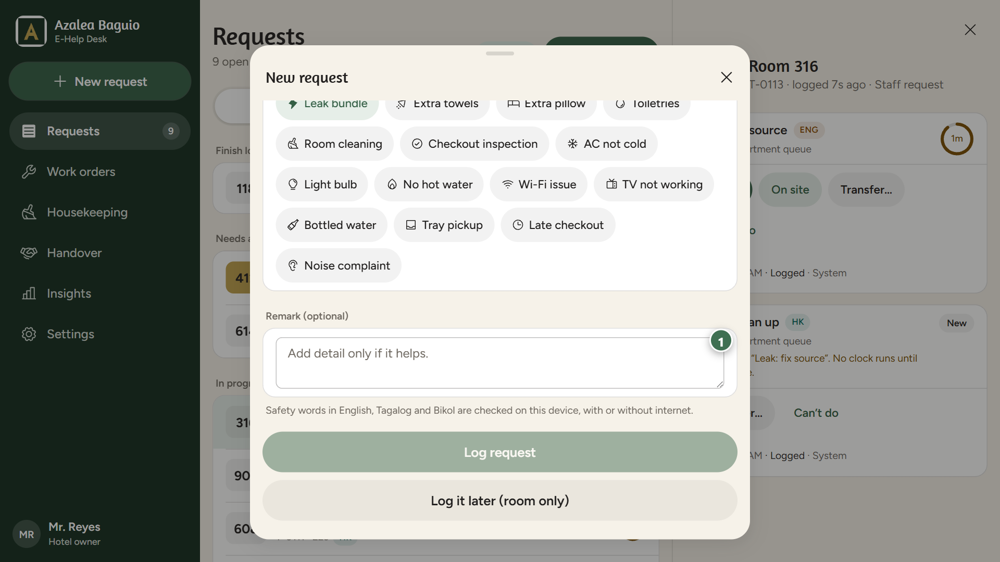

1. Remark box: here someone typed "may usok sa hallway". The desk notices while they type.

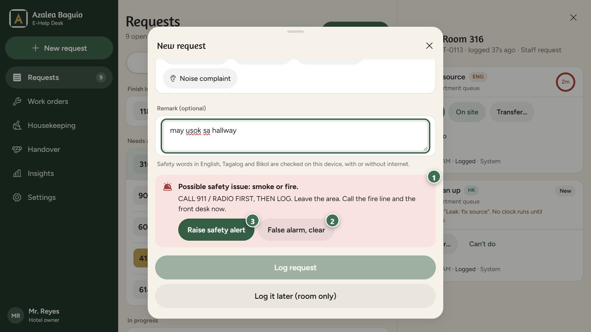

1. Safety warning: a red box says "Possible safety issue" and "CALL 911 / RADIO FIRST, THEN LOG." **Log request** turns off.
2. False alarm button: **False alarm, clear** empties the remark so you can go on.
3. Raise safety alert: opens the full-screen alert.

**Call 911 or use the radio first. Then log.** The desk does not call for you.

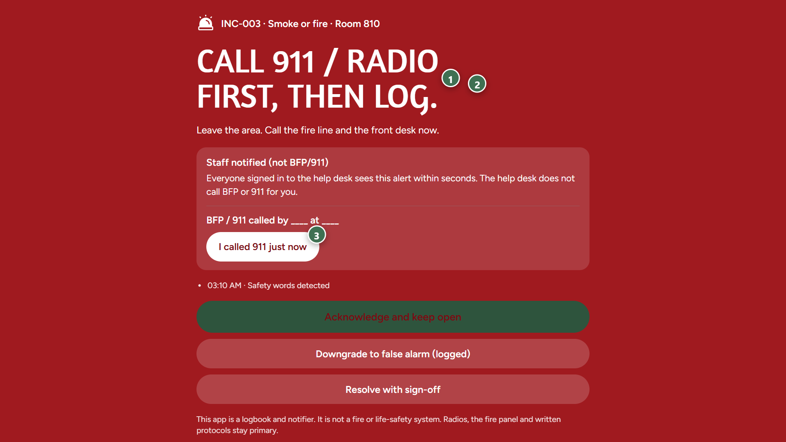

1. What to do first: big red words, then what to do for this kind of danger.
2. Who has been told: "Staff notified (not BFP/911)." Everyone signed in to the desk sees the alert within seconds. **BFP** is the fire department. The desk does not call BFP or 911 for you.
3. I called 911 just now: tap it after you make the call.

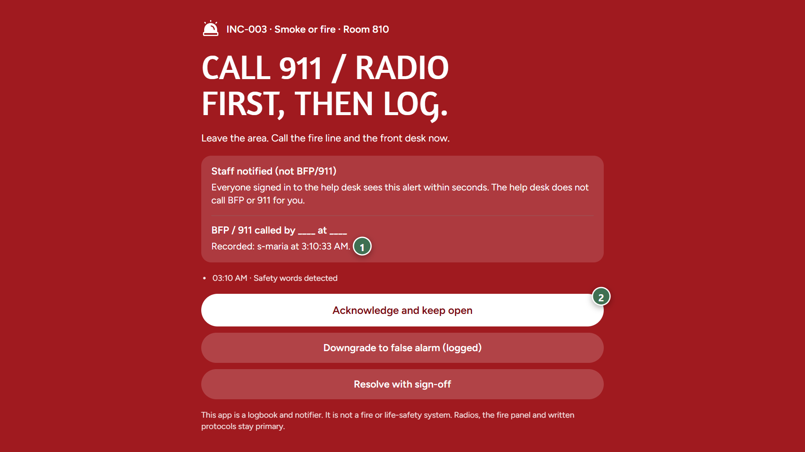

1. Who called and when: "Recorded: (name) at (time)." The record shows the name of the person signed in. It can be set **once**.
2. Acknowledge and keep open: closes the screen but keeps the alert open. The red banner stays on the Requests list.

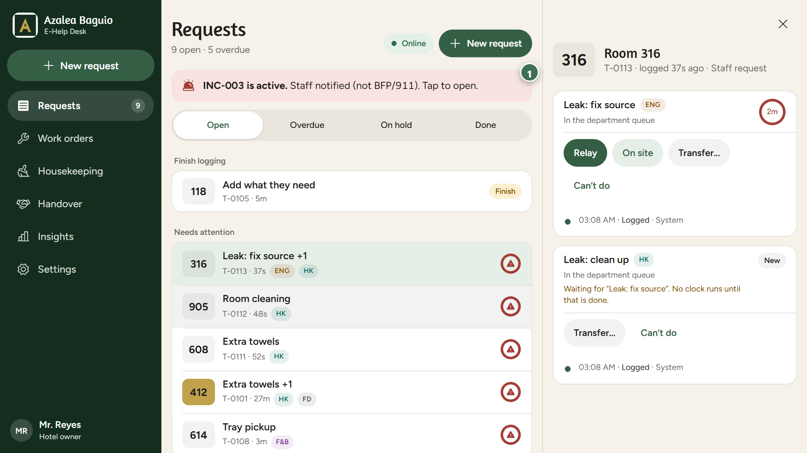

1. The red alert banner: everyone sees it until the alert is closed. Tap it to open the alert again.

**Several rooms.** If a second room reports the **same danger** within **15 minutes**, the desk adds it to the open alert. It says "Treated as one incident". It does not make a second alert. A different kind of danger starts its own alert.

**Closing an alert.** There are two ways.

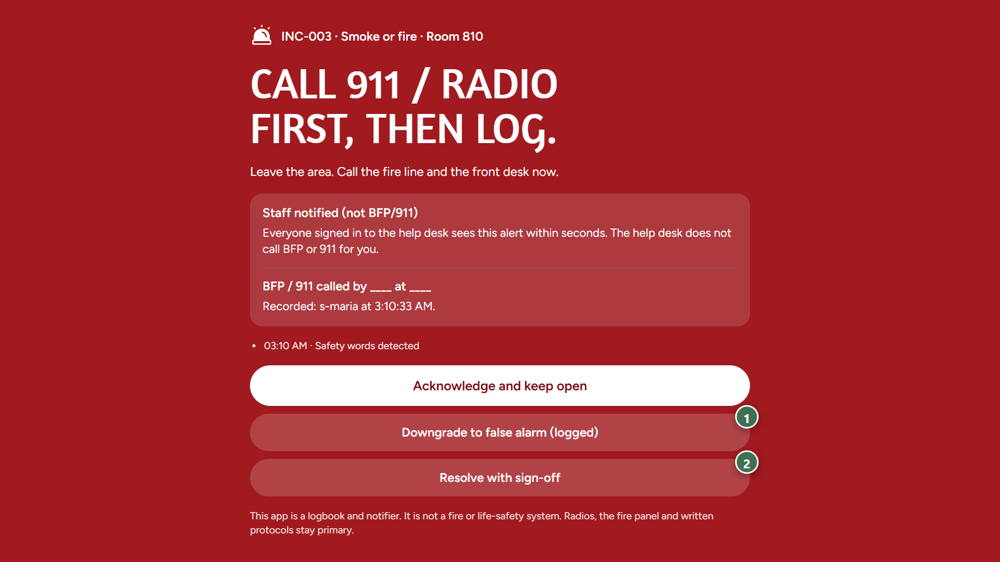

1. Lower to a false alarm: the button says **Downgrade to false alarm (logged)**. Anyone can use it. The note stays in the log.
2. Resolve with sign-off: only the **Hotel owner or a manager** can sign off. For others the button says "Resolve (manager sign-off required)" and is grey.

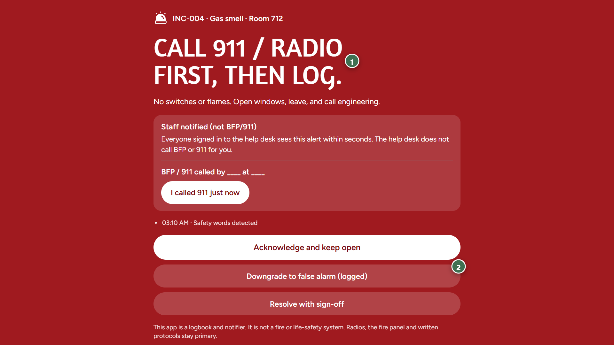

1. Safety words found: here a gas smell.
2. Downgrade to false alarm: it was a false alarm, so it is lowered. The log keeps it.

**While an alert is open:** the screen flashes and repeats a sound and a buzz every 5 seconds. You can turn sounds and buzzes off in Settings. Leave them on for safety.

**Good to know**

- On the Paper kit there is an "Emergency card": CALL 911 / RADIO FIRST, THEN LOG.
- The alert never replaces the radio, the fire panel or your written safety plan.
- A request is **not** logged when you raise an alert. After the danger is handled, log the request if you still need one.

**If something looks wrong**

- *The warning came by mistake.* Tap **False alarm, clear**.
- *No warning for a real danger.* The desk only knows the words in the table. Always call first. Do not wait for the desk.
- *I cannot sign off.* Ask the owner or a manager.

### 4.5 Work orders

A **work order** is a repair job. It is for repairs that need more than a quick fix. It is followed from the first report to the final cost. It starts from a request: see "Escalate to work order" in [4.3](#43-a-request).

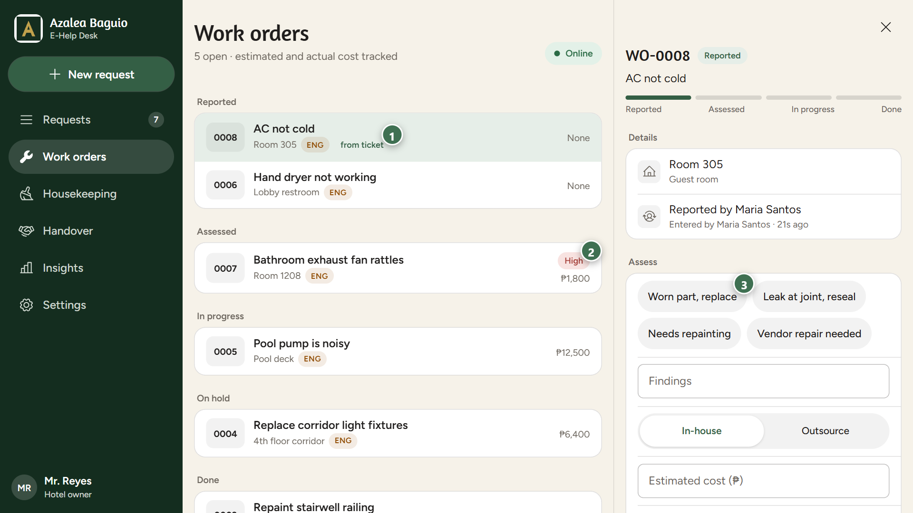

1. Job that came from a request: the tag "from ticket" shows where it began. Numbers like WO-0001 are job numbers.
2. High priority job: a red **High** tag.
3. Worn part, replace: each row shows the job, the room, the team and the cost. It shows the estimate until the final cost is known.

The groups are in order: **Reported**, **Assessed**, **In progress**, **On hold**, **Done**.

**1. Assess (stage Reported).** Someone looks at the problem.

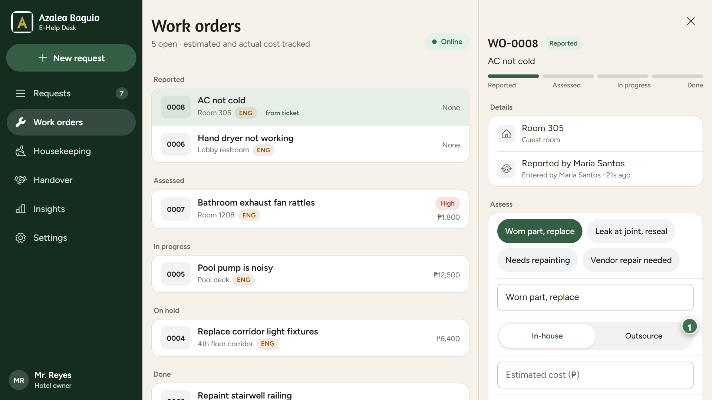

1. Outside contractor: tap a quick finding, or type your own in **Findings**. The starting findings are **Worn part, replace**, **Leak at joint, reseal**, **Needs repainting** and **Vendor repair needed**. Your hotel can change them ([4.12](#412-lists)).

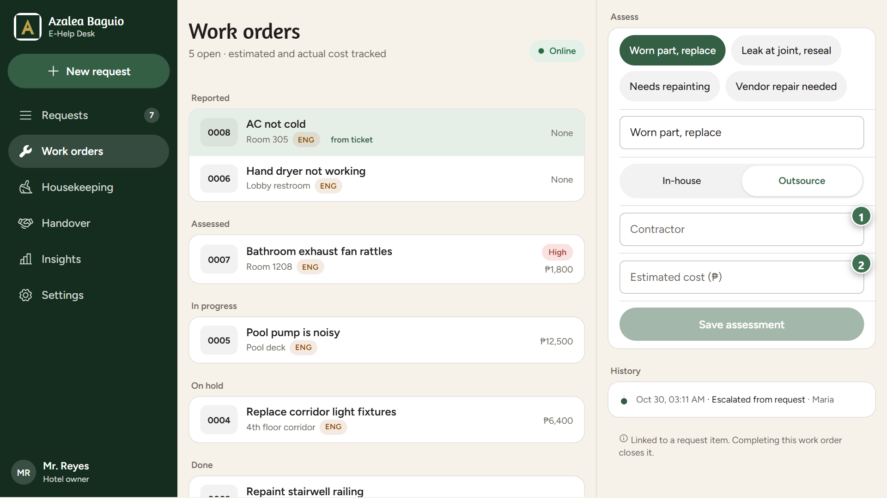

1. Company name: choose **In-house** (your own team) or **Outsource** (an outside company). For **Outsource**, type the company in **Contractor**.
2. Estimated cost: type the estimate in pesos. Numbers only.

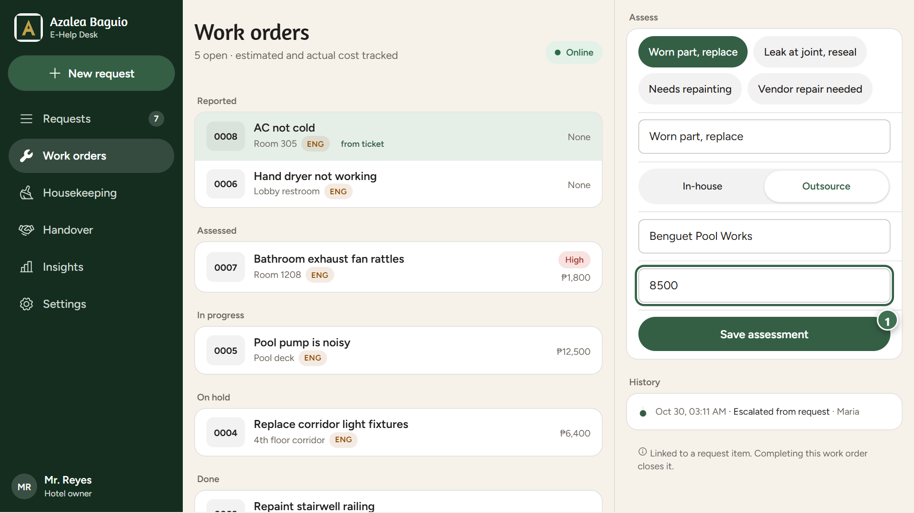

1. Save assessment: it turns on when you have a finding and an estimate. The job moves to **Assessed**.

**2. Start (stage Assessed).**

1. Estimated cost: shown in the cost bars.
2. Start work: tap it when the work begins. The job moves to **In progress**.

**3. In progress.** A bar shows how far the job is. Type the **Actual cost** when the work is finished. You can tap **Put on hold** if you must wait, for example for a part.

1. Progress bar: four steps: Reported, Assessed, In progress, Done.
2. Put on hold: pauses the job.

1. Resume work: a job on hold stays in the list until someone taps this.

**4. Complete.**

1. Final cost: type what the repair really cost, in pesos.
2. Complete: finishes the job. The button says "Complete and close ticket" when the job came from a request. That request is closed too.

1. Estimate and final cost: two bars. The final cost bar is **red** when it cost more than the estimate. It is green when it cost the same or less.
2. History: every step with the time and who did it.
3. Open Housekeeping: the next tab.

**Good to know**

- A work order takes the team of the request it came from.
- A finished job has a **Reopen** button. It puts the job back **In progress**.
- A job already open carries on if its team is later renamed or archived.
- An empty list says "No work orders yet." They start from a request.

1. Nothing yet: the screen explains that repair jobs start from a request.
2. Open Housekeeping: the next tab.

**If something looks wrong**

- *Save assessment is grey.* Add a finding and an estimate.
- *Complete is grey.* Type the final cost.
- *I cannot make a work order.* See "No Escalate button" in [4.3](#43-a-request).

### 4.6 Housekeeping

This tab shows rooms to clean, in the order they can be cleaned. **Housekeeping** is the team that cleans rooms.

1. Rooms ready now: the group **Ready to clean**.
2. Rooms waiting for the guest: the group **Guest still checking out**.
3. Start cleaning room 305: tap **Start**.

The groups, in order, are **Ready to clean**, **In progress**, **Guest still checking out**, **Scheduled** and **Done**. Each row shows the room, the type of task and who it is assigned to ("Unassigned" if nobody).

**How a room becomes ready:**

- The desk makes it ready when someone finishes a **checkout** or **inspection** need for that room. The Requests screen shows a message: "Room 305 is ready for cleaning. Housekeeping was told."
- Or you tap **Mark ready** on a room in **Guest still checking out** or **Scheduled**. Do this when the guest has left.

1. Room being cleaned: the room moved to **In progress**.
2. Mark room 611 ready: tap **Mark ready** when the guest has left.

1. Finish room 305: when the room is finished, tap **Done**.

1. Finished room: finished rooms go to **Done** at the bottom.
2. Open Handover: the next tab.

**Good to know**

- A grey banner explains: finish a checkout or inspection need and that room turns **Ready** by itself.
- Finished rooms stay on the screen for 24 hours.
- An empty screen says "No cleaning tasks right now." Tap **Log a cleaning request** to log one yourself.

1. Nothing to clean: the screen offers to log a cleaning request.

**If something looks wrong**

- *A room I expect is not here.* Check **Guest still checking out** and **Scheduled**.
- *The list is empty.* Nothing is waiting. Log a cleaning request if a room needs it.

### 4.7 Handover

A **shift** is one working period, for example 6 a.m. to 2 p.m. A **handover** is when one shift passes the work to the next. The screen is titled **Shift handover**. It says: "One screen for the next officer. Nothing lives in someone's head."

1. The four numbers: **Open**, **Overdue**, **On hold** and **Rooms to clean**. Overdue is red when it is above zero. On hold is amber.
2. Promises made to guests: VIP rooms and late-checkout requests. The incoming person owns these from the first minute. Tap a row to open it.
3. Items left by someone off shift: the group **Owner went off shift** (see below).

Another group can show: **Already overdue**. These are the first five late items, "inherited from the last shift". They do not count against you.

1. Return to the team queue: requests that belong to a person who went off shift have no one on duty. Tap **Return (number) to the department queue**. They go back to their team.

1. Acknowledge handover: when the next person has read the screen, they tap it.

1. Who signed and when: "Acknowledged by (name) at (time). The outgoing officer is released."
2. Open Insights: the next tab.

**Good to know**

- Anyone with the Handover tab can sign.
- The sign-off counts for one shift (8 hours). After that the next person can sign again. The screen shows who signed last.
- Handover shows the whole hotel, not just your department.

**If something looks wrong**

- *No "Owner went off shift" group.* It shows only when a request belongs to someone marked as off shift.
- *The numbers look high.* Tap a promised or overdue row to see the request.

### 4.8 Insights

**Insights** gives live counts for the whole desk, by department. It says: "No rankings of people." Hotel owners, managers and supervisors can open it. Shared phones cannot.

1. The six numbers: **Tickets logged this shift**, **Items open**, **Overdue**, **On hold**, **Work orders open** and **Rooms ready to clean**.
2. Scores by department: for each team, two bars. **Relay** is the share sent to the team within 2 minutes. **Completion** is the share finished within the target time. Time on hold does not count. A bar turns green at 80% or more, amber from 60%, red below 60%. A dash means there is nothing to measure yet.

1. Held longest: the five longest waits. The department head follows these up. "An item on hold never silently expires."
2. Open Settings: the next tab.

**Good to know**

- "This shift" means the last 8 hours.
- Scores are for teams. The desk never ranks people.

**If something looks wrong**

- *A department is missing.* It only shows when it has at least one item.
- *"Department scores appear once tickets are logged and acknowledged."* Nothing is there to score yet.

### 4.9 Settings

**Settings** is where you make the desk comfortable. It says: "Comfortable at 3 a.m. on a shared phone." What you see depends on who you are ([section 2](#2-who-can-do-what)). Owners and managers also see **Staff** and **Lists**. Owners also see **Logins**.

At the top, **Signed in** shows your name and role. **Switch person** goes back to the name and PIN screen. **Back to my own account** shows when you are acting as a PIN person.

The display options belong to **this device only**.

1. Reduce motion: turns off movement. It follows your device setting unless you switch it on here.
2. Higher contrast: the switch is called **Increase contrast**. It makes text and lines stronger.
3. Larger text: the **Text size** bar has five steps: **Small**, **Default**, **Large**, **Larger**, **Largest**.

1. Higher contrast: the whole screen is larger now. This change is only for this device.

1. Contrast off: switch it off the same way you switched it on.
2. Normal text size: slide back to **Default**.

1. Vibration: a short buzz on taps. A strong buzz for safety. Only phones with a vibration motor buzz.
2. Sounds: only safety alerts and finished items make a sound.
3. Keyboard shortcuts: **N** for a new request. **1** to **6** to switch tabs. Turn them off if you use voice control or a screen reader.

On a phone, tap **More** at the bottom to find **Insights**, **Settings**, **Paper kit**, **Switch person** and **Sign out**.

1. More screens: **Insights** and **Settings** are here.
2. Paper forms: **Paper kit** (see below).

**Paper kit.** If power or battery fails, work goes on paper. The kit lists the forms: a request and call log, an in-house list printed each morning, the emergency card and the shift handover sheet. It also gives three steps for when power returns: enter the paper notes in time order, mark each as entered so nothing is entered twice, and file the sheets with the shift report.

1. Paper request log: a table with Time, Room, What, Who and Done.
2. Close: closes the kit.

**Good to know**

- Settings for text, contrast and motion stay on your device. Another phone is not changed.
- A shared phone has no Settings. Set up the phone before you hand it over, or ask a manager.

**If something looks wrong**

- *I do not see Staff, Lists or Logins.* Your kind of person does not include them ([section 2](#2-who-can-do-what)).
- *Staff and Lists are gone after Switch person.* They show only on your own account. Tap **Back to my own account**.

### 4.10 Staff

Owners and managers use this. **Settings, Staff** is the list of people who sign in with a **PIN** on a shared phone. The note says: "PINs are never shown again; set a new one if it is forgotten."

1. Staff list: each person with their job title and role.
2. Remove a person: **Remove** asks "Remove (name)? They will no longer be able to sign in." Their past work stays in the history.
3. Set a new PIN: **Set PIN** opens a small box for a new PIN.

1. New PIN: type four digits. They show as dots.
2. Save the PIN: tap **Save**. The message says "New PIN set for (name)." A new PIN also clears a lock.

1. Full name: up to 80 characters.
2. Job title: pick a suggestion or type any title (up to 60 characters). If the title is new, tap **Add "(title)" to the list** so it is suggested next time.
3. Department: choose a team, or **No department**. The roles you can give are **Desk officer**, **Staff** and **Supervisor**. (The role box sits next to this one.)
4. Four-digit PIN: type the first PIN. Tell the person privately.
5. Add person button: it turns on when the name, the title and four digits are filled.

**PIN rules** ([section 3.4](#34-the-shared-phone-pick-your-name-type-your-pin)): four digits. Not a repeat (1111). Not a straight run (1234, 4321). The desk says "Pick a PIN that is not a repeat or a straight run, like 1111 or 1234."

**Good to know**

- **Staff** with a department see their own team's work first.
- A new person is on shift from the start.
- Removing a person is not the same as deleting history.

**If something looks wrong**

- *"The PIN must be four digits."* Type exactly four numbers.
- *"Pick a department."* The team you chose may be archived. Pick another.
- *A person is locked.* Set a new PIN. This clears the lock.

### 4.11 Logins

Only the **hotel owner** sees this. **Logins** are for people who sign in with their own **email and password**: managers, supervisors and shared phones. People with a PIN are in **Staff**.

1. The logins list: name, email and kind. You are listed first, marked "(you)".
2. Switch off a login: **Switch off** asks "Switch off (name)'s login? They are signed out everywhere and cannot sign in until you switch it on again."

1. Switched off label: an amber **Switched off** tag shows.
2. Switch it on again: **Switch on** lets the person sign in again.

1. Name: up to 80 characters.
2. Email: they get an email to set their password.
3. Role: choose **Manager: runs the desk and the staff list**, **Supervisor: runs the desk, no staff list** or **Shared phone: every action needs a staff PIN**.
4. Add login: tap it. The message says "(Name) added. They get an email to set their password."

1. The new login: the person is listed and emailed a link.

**The email.** The subject is "(Hotel name): your help desk account". It says an account was made, gives a link to choose a password and says to sign in with the same email. The link works **once** and ends after **one day**. The password needs at least 10 characters.

**Good to know**

- You cannot delete a login. You can only switch it off. The person is signed out everywhere at once.
- You cannot switch off your own login.
- Only managers, supervisors and shared phones can be added here. The hotel owner login is made by the web team.
- If an email is already used, the message says "An account with that email already exists."

**If something looks wrong**

- *"Enter a valid email address."* Check for a typo.
- *The email did not arrive.* Check the spam folder. Then tell the web team ([section 8](#8-common-questions-and-fixes)). The person can also use **Forgot password?** on the sign-in page.

### 4.12 Lists

Owners and managers use this. **Lists** are your hotel's own choices. They say: "Changes reach every phone within a few seconds. Old requests keep the names they were logged with."

There are six lists.

1. Lists section: each row shows its name, how many are active and how many are archived.
2. Open Departments: tap a row to open that list in a sheet.

| List | What it holds |
|---|---|
| **Departments** | The teams that receive requests, like Housekeeping or Spa. |
| **Request types** | The buttons on a new request. Each goes to one department with a target time. |
| **Bundles** | One tap that sends several steps to different teams, like a leak. |
| **Hold reasons** | Why a job is waiting. The clock pauses while it is on hold. |
| **Job titles** | Suggestions when you add a person. Any title still works. |
| **Work-order findings** | Quick answers when someone assesses a repair. |

**How every list works:**

- Edit what you like. Nothing changes for others until you tap **Save changes**. The button says **Saved** when there is nothing to save.
- Use the up and down arrows to change the order. The order is the order of the buttons.
- **Add (item)** adds a row. A new row has a **New** tag.
- **Archive** hides an item from new work. Old requests keep its name. An archived row has an **Archived** tag. **Restore** brings it back.
- **Delete** removes an item. It goes when you save. This cannot be undone.
- Closing with unsaved changes asks "Discard your changes?"
- A name can be up to **40 characters**. The same name cannot appear twice in a list.
- Limits: 40 departments, 80 request types, 20 bundles, 20 hold reasons, 60 job titles and 20 findings.
- If someone else saves first, you see "Someone else changed this list. Your screen was refreshed; try again."

**Archive or delete? What "in use" means.** A department or a hold reason is **in use** when people, requests or repair jobs still use it. The row says, for example, "In use: 3 people, 12 requests and 1 work order." Otherwise it says "Not used by any record yet." An item in use **cannot be deleted**. The desk says "Used by ... Archive it instead." Archive it. Request types, bundles, job titles and findings can be deleted. Old requests keep their names.

**Departments**

1. Badge shown in lists: a short code of up to 6 letters (for example HK).
2. Handles repairs: tick it if the department's needs can be turned into work orders. At first Engineering and IT have it. New departments do not.
3. How much it is used: for example "In use: 5 people, 12 requests".
4. Add a department: tap **Add department**.

1. Department name: for example Spa.

1. Badge: filled in for you. You can change it.
2. Save changes: makes it available everywhere.

1. Saved message: "Departments saved. Every phone gets them on its next refresh."
2. Try to delete Housekeeping: it is in use.

1. Why it cannot be deleted: "Used by ... Archive it instead."
2. Archive Housekeeping: the right choice. When people or requests use it, the desk first asks if you want to hide it from new work.

1. Archived label: it is hidden from new work and keeps its name on old requests.
2. Close the list: tap the cross at the top of the sheet.

Rules for departments:

- Keep **at least one** department active.
- A department used by an **active** request type or bundle cannot be archived. Move or archive those first. The message says "(Name) is used by ... Archive them or move them to another department first."
- While a work order is open, keep at least one active department that **handles repairs**.
- Renaming a department changes its name on screen. Old work keeps working.

1. Department name: for example change IT to IT Support.
2. Save changes: tap it.

**Request types**

1. Department and target time: each type has a department and a target time in minutes (1 to 1440).
2. Icon of the request: a small picture. Tap **Change** to pick another.
3. Add a request type: tap **Add request type**.

1. Request name: up to 40 characters.
2. Department: only active departments show.
3. Target in minutes: how long the team has after it takes the job.
4. Change the icon: opens the picture choices.

1. Spa icon: tap the picture that fits. Tap **Done** to close the choices.

1. Save changes: adds the button to the New request screen.

1. Saved message: the new type is saved for every phone.
2. Close the list.

1. Massage booking button: it appears in **What they need**.

A request type you archive says "Hidden from new requests. Goes to (department)."

**Bundles**

1. Steps of the bundle: each step has a name, a department and a target. A bundle has 1 to 6 steps.
2. Waits for the step before: tick **Starts after step (number) is done**. A step can only wait for an earlier step.
3. Add a step: tap **Add a step**.

Write a short line in **What it does**. It shows under the buttons on New request. Up to 120 characters.

**Hold reasons**

1. In use right now: how many requests are on hold for that reason.
2. Close the list.

Keep at least one active hold reason.

**Job titles**

1. The job titles: suggestions when you add a person ([4.10](#410-staff)).
2. Close the list.

**Work-order findings**

1. The findings: quick answers when someone assesses a repair ([4.5](#45-work-orders)).
2. Close the list.

**How changes reach every phone.** When you tap **Save changes**, the list is stored once for your hotel. Each open desk checks for news every few seconds (usually 5, never more than 30). The change appears on its own. Nobody has to sign in again.

**Good to know**

- The list names, short codes, targets, icons and order can change at any time.
- What cannot change: the statuses (like On site), the danger words, and the role names. The desk's rules depend on them.
- Supervisors and shared phones do not see the Lists section.

**If something looks wrong**

- *"Pick an active department, or archive this first."* A request type or bundle step points to an archived department. Choose another.
- *"Keep at least one active department."* You archived every one.
- *My changes vanished.* Someone saved first, or you closed without saving. Make the changes again.

## 5. A day as each kind of person

### 5.1 A day as the hotel owner

1. Sign in. Tick **Keep me signed in** on your own phone. You see every tab.

1. Every tab: requests, work orders, housekeeping, handover, insights and settings.
2. Open Settings: this is where your extra tools are.

2. Open **Settings**. Find your own lists. Tap **Departments** to change one.

1. Your own lists: the six lists.
2. Departments: tap it to open the list.

3. Change a name, for example IT to IT Support. Tap **Save changes**.

1. Department name: type the new name.
2. Save changes: tap it.

1. Saved message: every phone gets the new name.
2. Close: close the list.

4. Give a manager a login. Type the name and email. Choose **Manager**. Tap **Add login**.

1. Name.
2. Email: the manager gets an email to choose a password.
3. Role: choose Manager.
4. Add login.

1. The new manager login: you can switch it off at any time.
2. Open Insights: the next tab.

5. Open **Insights** to see the live counts.

1. The numbers: the live counts and the department scores.
2. Open Handover: the next tab.

6. At the end of the shift, open **Handover**. Read it. Tap **Acknowledge handover**.

1. Acknowledge handover: tap it when you have read the list.

1. Who signed and when: your name and the time.

### 5.2 A day as a manager

1. Sign in with your email and password. You see every tab and the same request list as everyone.

1. Every tab: six tabs.
2. Signed in as manager: your name and role.
3. Start a new request.

2. Open the red and gold rows in **Requests** first.
3. If a receptionist types a danger word, you see the red warning.

1. Safety warning: call 911 or use the radio first.
2. Raise safety alert: opens the alert.

4. Record the 911 call. When the danger is over, tap **Resolve with sign-off**.

1. What to do first.
2. I called 911 just now.
3. Resolve with sign-off: only the owner and managers can do this.

5. Open **Settings**. A manager has **Staff** and **Lists**, and no **Logins**.

1. Display follows Lists: the display options come after Staff and Lists.

6. Add a new person to the staff list with a PIN.

1. Full name.
2. Job title.
3. Department.
4. Four-digit PIN.
5. Add person.

1. The new person: they can now sign in on a shared phone with their PIN.

7. Change the words of a hold reason so they fit your team. Tap **Save changes**.

1. Hold reason name.
2. Save changes.

1. Saved message.
2. Close.

8. At shift end, open **Handover**. Return unassigned requests to their team. Sign it.

A manager cannot add logins. Ask the hotel owner.

### 5.3 A day as a supervisor

1. Sign in with your email and password. You start on **Requests**.

1. Open requests: what is open, late or on hold. Use **My department** or **All departments**.
2. Open Work orders: the next tab.

2. Open a request. Tap **Relay**, **On site** and **Done**. Hold, transfer or escalate when needed.
3. Follow repair jobs in **Work orders**.

1. Repair jobs by stage.
2. Open Housekeeping: the next tab.

4. Check which rooms are ready to clean in **Housekeeping**.

1. Rooms to clean.
2. Open Handover: the next tab.

5. Check **Handover** before the next shift starts.

1. Shift numbers.
2. Open Insights: the next tab.

6. Check **Insights** for your department.

1. The numbers.
2. Open Settings: the next tab.

7. If a safety alert starts, record the 911 call. Ask a manager or the owner to sign off.

1. Only display options: no Staff, Lists or Logins. Ask a manager for changes.

### 5.4 A day on a shared phone

1. Pick up the phone. It shows **Who's on shift?** Tap your name. Tap your four-digit PIN.

1. Names: every person on shift.
2. Pick a name: tap your card.
3. to 6. Your PIN: tap your four digits.

2. The desk opens with four tabs. If you are **Staff** with a department, you see your department's work first. Tap **New request**.

1. Four tabs only: no Insights and no Settings.
2. Start a new request.

3. Tap the room number.

1. First digit: 4.
2. Second digit: 1.
3. Third digit: 8.

4. Tap what the guest needs. Tap **Log request**.

1. Extra pillow: tap what the guest asked for.

1. Log request: the request is saved under your name.

5. The request appears in your department's list. Tap it.

1. The new request.
2. Open the request: tap it.

6. When you reach the room, tap **On site**.

1. On site.

7. When the work is done, tap **Done**.

1. Done.

1. History with your name.
2. Open the person menu: use it to hand the phone over.

8. When your shift ends, tap **Switch person**. The next person signs in with their own PIN.

1. Switch person.

For danger, call 911 or use the radio first. If the phone says "Your PIN sign-in has ended", just sign in again.

## 6. On your phone and when the internet drops

**On a phone** the screen changes shape:

- The hotel name is at the top, with the connection chip and your round picture.
- The tabs are at the bottom: **Requests**, **Work orders**, **Housekeeping**, **Handover** and **More**.
- A big **New request** button floats on the Requests tab.
- Tap a request to open it as a sheet.

1. Hotel name and logo.
2. Connection shows Online.
3. Bottom tabs.
4. New request button: big enough for a thumb.
5. Open More: for Insights, Settings, Paper kit, Switch person and Sign out.

### 6.1 The main screens on a phone

1. Email box.
2. Password box.
3. Sign in.

1. First digit: tap **4**.
2. Second digit: tap **1**.
3. Third digit: tap **2**. The room reads 412.

1. Extra towels: scroll down and tap what the guest needs. Then tap **Log request** at the bottom.

1. Next step button: the big button does the next step (**Relay**, **On site** or **Done**).
2. History: the steps so far.

1. Safety warning: a red box appears before the request is sent.
2. Raise safety alert: opens the full-screen alert.

1. What to do first: it fills the screen. Call 911 or use the radio first.
2. I called 911 just now: records the call.
3. Resolve with sign-off: for the hotel owner or a manager.

1. A repair job: tap it to open it.
2. Open Housekeeping: the next tab.

1. Rooms ready to clean: tap **Start** on a room.
2. Open Handover: the next tab.

1. Shift numbers: the same numbers and the same sign-off button as on a computer.

1. Nothing open: an empty list invites you to log the first request.
2. New request button.

### 6.2 When the internet drops

**What you see and what happens:**

1. The chip turns to **Offline**. If changes are waiting, it adds the count, for example "Offline · 2 waiting". A message says the device will catch up.
2. Keep working. You can still log requests, send them to the team, mark work and so on. Each change is **saved on your phone**.
3. A small cloud mark shows on a request that has not been sent.
4. When the connection returns, the desk sends the waiting changes **one by one, in order**. The chip says **Syncing** and the count while it works. Then it says **Online** again. Nothing is sent twice.
5. The desk then refreshes the list with what everyone else did.

1. Log request: it works with no internet. The desk keeps it safe on the phone.

1. Offline chip with waiting count: it says Offline and how many changes wait.
2. Request waiting to send: it shows a small cloud mark.

1. Online again: the chip is green.
2. Request now sent: the cloud mark is gone.

**Good to know**

- Changes wait on the phone, even if you close the page. They go out when you open the desk again with a connection.
- While changes are waiting, you may not see what others did. This fixes itself after sending.
- A danger-word check works with no internet.
- If the page is closed during an outage, it may not open again until the connection returns. Open the desk before you start a shift and leave it open.
- If a waiting change is refused when it is sent, the desk shows the reason. A common reason is a PIN sign-in that ended. Sign in with your PIN and log it again.
- If power and battery are gone, use the **Paper kit** ([4.9](#49-settings)).

## 7. Your hotel's own look

Each hotel has its own colours, name and logo. The screens work the same way.

- **Azalea Baguio:** forest green on a soft oat colour. Gold shows in small tags.
- **Azalea Boracay:** teal on a warm cream.

The sign-in page and the desk both use your hotel's look.

1. Hotel name and logo: Azalea Boracay.
2. Teal colour of the hotel: the active tab and buttons are teal.

1. Hotel name and logo.
2. New request button.

**Each hotel's lists and people are its own.** The departments, request types, hold reasons, staff, logins and all requests of Baguio are never seen at Boracay. A change in one hotel does not change the other.

## 8. Common questions and fixes

**I cannot sign in.**
Check your email and password. Use **Forgot password?** if you are unsure. If the message says "Too many attempts", wait for the number of minutes it shows. If your login was switched off, ask the owner to **Switch on**.

**It says "Too many attempts. Try again in 15 minutes."**
The sign-in is paused after 5 wrong tries (or 20 in an hour from one place). Wait. Do not keep trying.

**My PIN does not work.**
Pick your own card first. Type four digits slowly. After 5 wrong PINs you are locked for 15 minutes. Wait, or ask a manager to set a new PIN.

**I forgot my PIN.**
Nobody can see it. Ask a manager or the owner to open **Settings, Staff, Set PIN**. A new PIN clears a lock.

**The desk says "Your PIN sign-in has ended."**
A PIN sign-in lasts 12 hours. Tap **Switch person** and sign in again.

**The request went to the wrong department.**
Open it. Tap **Transfer…**. Tap the right team.

**A list name changed on my screen.**
A manager or owner edited the lists. The change arrives in a few seconds. Old requests keep the name they were logged with.

**A request or button disappeared.**
- A finished request moves to the **Done** tab. The Done tab shows the last 12.
- The desk stops showing finished requests after about 2 days. Finished repair jobs stay for 14 days. Finished rooms stay for 24 hours. Closed safety alerts stay for 7 days. The records are not deleted. Ask the web team if you need an old one.
- A button may have been archived in **Lists**.
- Check **My department** against **All departments**.

**The email for a new login or a password link did not arrive.**
Look in the spam folder. If it is not there, tell the web team. The email may be going to spam or may not leave the website ([section 10](#10-for-the-web-team-only)). The owner can ask the person to use **Forgot password?** after the problem is fixed.

**I typed the wrong room.**
You cannot edit a room after it is logged. Open the request and tap **Can't do** to close it. Then log a new request with the right room. Tell the team.

**I tapped something by mistake.**
Most steps cannot be undone. The only undo is **Undo escalation**. Tell your manager. Every step is in the history.

**The screen is too small to read.**
Open **Settings** (on a phone, **More**, then **Settings**). Slide **Text size** to a bigger step.

**Who sees my name?**
Every step in a request's history shows the time and the first name of the person who did it.

## 9. Words used in this guide

**Archive.** Hide a list item from new work. Old requests keep its name. You can restore it.

**Badge.** A short code of up to 6 letters for a department (for example HK).

**BFP.** The Bureau of Fire Protection. The fire department.

**Bundle.** One tap that sends work to several teams, in order. For example "Leak".

**Checkout.** The guest leaves the room.

**Department.** A team that gets requests: Housekeeping, Engineering, IT, Food & Beverage, Front Desk or Security. Your hotel can add more.

**Desk officer.** A staff role. Someone who works the front desk.

**Done.** Finished.

**Engineering.** The team that fixes things in the building, like air conditioners and lights.

**Escalate to work order.** Turn a request into a repair job.

**Front desk.** Where guests check in and call for help.

**Food & Beverage (F&B).** The team for food and drinks.

**Handover.** When one shift passes the work to the next.

**Hold (On hold).** A need that waits. Its timer stops.

**Housekeeping.** The team that cleans rooms.

**Insights.** The tab with live counts by department.

**Job title.** The name of someone's job, like Room Attendant.

**Login.** An email and password that lets a person sign in.

**On site.** Someone is at the room doing the work.

**Overdue.** Took longer than its target time.

**PIN.** A four-digit number. A staff person uses it on a shared phone.

**Relay.** Send a request to its team.

**Request.** One guest need, like "extra towels". Also called a ticket.

**Request type.** One of the buttons on New request.

**Room attendant.** A person who cleans rooms.

**Safety alert.** A red full-screen warning about danger.

**Shared phone.** A phone many staff use. Each person signs in with a PIN.

**Shift.** One working period, for example one day or one night.

**Target time.** How many minutes a team has to do a job.

**Ticket.** Another word for a request, with a number like T-0101.

**VIP.** A guest who needs special care. Their requests go to the top.

**Work order.** A repair job followed from report to final cost.

## 10. For the web team only

This part is for the web team. It may use technical words.

**The first Hotel Owner.** Only the web team creates it. In WordPress open **Users, Add New**. Choose the role **Hotel Owner**. The owner then adds managers, supervisors and shared phones inside the desk (**Settings, Logins**). Hotel roles hold no WordPress powers. The desk sends them to `/helpdesk/` whenever they sign in. They never see the WordPress admin area, and the admin bar is hidden. Logins cannot be deleted, only switched off.

**Hotel name, look and room list.** In wp-admin open **E-Help Desk, Settings**. Fields: **Property name** (shown on the desk), **Look** (Azalea Baguio, Azalea Boracay or "Detect from the site address"), **Rooms** (one per line; the desk keypad does not check against it), **Refresh every** (5 to 30 seconds) and **On uninstall** (keep or delete data; off by default). Deactivating the plugin never deletes data.

**Updates.** Build the zip (`npm run build:wp`, then `npm run zip:wp`). Back up first. Upload and activate as in `docs/WORDPRESS-PLAN.md` section 6. The host may cache PHP files for about 90 seconds. Roll back by deactivating the plugin; data stays.

**Email, still to do.** Password links and new-login emails go out with `wp_mail`. They may land in spam, or may not be delivered at all. A real sending mailbox is needed. Set up an SMTP plugin or a mail service with a real sender address. Then send a test "Forgot password" email on both hotels. The sign-in link works once and ends after one day.

**Backups.** UpdraftPlus covers the database. Take a backup before each update. Ask the host to confirm the schedule.

**Other items from the plan.**

- Exclude `/helpdesk/` from page caching and from tracking scripts. The desk and its address `/wp-json/azl-ehd/` must never be cached.
- A planned item: confirm ModSecurity is back on after the upload tests (`docs/WORDPRESS-PLAN.md` section 11). Delete the old install zips under `wp-content/uploads/azl-ehd-upload/`.
- To confirm on the live site: how rooms first appear in Housekeeping, and how a person is marked "off shift". We found no screen for the second.
- A wp-admin sign-in as a desk role should land on the desk. This is still to test with a real non-admin account.
